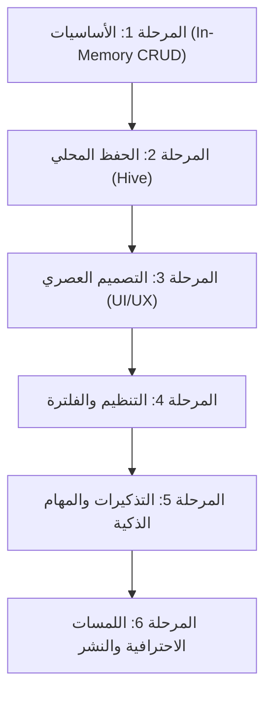

# 📋 وثيقة خطة مشروع تطبيق المهام (To-Do App)
> **الهدف الأساسي:** الفهم العميق وتثبيت المفاهيم الهندسية في Flutter، وليس مجرد إنجاز تطبيق تقليدي.

---

## 🛠️ القرارات التقنية الثابتة (Architectural Decisions)

| المجال | التقنية المختارة | التفاصيل والتبرير |
| :--- | :--- | :--- |
| **المعمارية (Architecture)** | **Clean Architecture** (Feature-First) | تقسيم المشروع لـ 3 طبقات: (Domain, Data, Presentation) لفصل منطق الأعمال عن الواجهات وقواعد البيانات. |
| **إدارة الحالة** | **Cubit** (`flutter_bloc`) | أبسط من Bloc الكامل (بدون Events معقدة)، مباشر، ومثالي لفهم دورة حياة الحالة. |
| **التخزين المحلي** | **Hive** (`hive_ce`) | تخزين كـ `Map<String, dynamic>` بدون Code Generation أو `build_runner` لتبسيط الفهم والتحكم اليدوي. |
| **إدارة النسخ (Git)** | **Conventional Commits & Git Flow** | التزام بالـ Commits الذرية (Atomic Commits)، الفروع المنظمة (`main`, `develop`, `feature/`), ورسائل موحدة احترافية. |
| **نظام التصميم** | **Material 3** | استخدام أحدث معايير التصميم من Google مع Dynamic Color و ColorScheme متناسق. |
| **اللغة والاتجاه** | **العربية أولاً (RTL)** | بناء الواجهات متوافقة مع الاتجاه من اليمين لليسار، مع تهيئة البنية لدعم الإنجليزية لاحقاً. |

---

## 🎯 منهجية العمل (Workflow Protocol)

1. **النقاش التعليمي أولاً:** قبل كتابة أي سطر في كل مرحلة، نناقش:
   * ما هي المشكلة التي نحلها؟
   * ما هي المفاهيم البرمجية التي سنتعلمها؟
2. **بوابة الاعتماد (Validation Gate):** لا ننتقل إلى مرحلة جديدة نهائياً إلا بعد تشغيل المرحلة السابقة بنجاح على جهازك والتأكد من استيعابها.
3. **التغذية الراجعة (Feedback Loop):** بعد كل مرحلة، تؤكد ما اشتغل معك وما واجهت فيه صعوبة لمناقشته وتثبيته.

---

## 🌿 بروتوكول Git الاحترافي (Professional Git Workflow)

### 1. هيكل الفروع (Branching Strategy):
* `main`: يحتوي على الكود المستقر والنهائي فقط.
* `develop`: الفرع التراكمي للتطوير اليومي.
* `feature/phase-1-basics`, `feature/phase-2-hive`, ... إلخ: فرع مستقل لكل مرحلة، يُدمج في `develop` بعد اكتمال واختبار المرحلة.

### 2. معايير رسائل الـ Commit (Conventional Commits):
* `feat:` لإضافة ميزة أو ملف جديد (مثل: `feat(domain): add task entity and repository contract`).
* `fix:` لإصلاح خطأ أو تعديل سلوك غير مقصود (مثل: `fix(cubit): prevent duplicate task ids`).
* `refactor:` تعديل على الكود لتحسينه بدون تغيير الوظيفة.
* `chore:` مهام ضبط البنية والاعتماديات (مثل: `chore: setup clean architecture folders`).
* `docs:` توثيق أو تحديث الخطط والتعليمات.
* `test:` كتابة أو تعديل اختبارات.

### 3. الالتزامات الذرية (Atomic Commits):
* عدم تجميع كل شغل المرحلة في Commit واحد كبير.
* كل تغيير منطقي ومستقر يُسجّل في Commit منفصل مع رسالة شارحة وواضحة.

---

## 🗺️ خطة المراحل التفصيلية (Project Phases)

---

### المرحلة 1: الأساسيات (In-Memory Core)
* **المحتوى:**
  * إنشاء المشروع وهيكلية المجلدات النظيفة (Feature-first).
  * تصميم نموذج المهمة (`TaskModel`).
  * بناء `TaskCubit` و `TaskState`.
  * شاشة رئيسية واحدة لعرض المهام.
  * عمليات الـ CRUD في الذاكرة: إضافة، تعديل، حذف (مع زر التراجع `Undo` عبر `SnackBar`)، وتغيير حالة الإنجاز.
* **المفاهيم المكتسبة:**
  * فهم كيفية عمل الـ `Cubit` والـ `Emit` للـ States المختلفة.
  * التعامل مع القوائم غير القابلة للتعديل (`List.unmodifiable` / Immutability).
  * كيفية استعادة عنصر محذوف فورياً.
* **معيار الانتهاء (Done When):** تستطيع إدارة المهام بالكامل داخل التطبيق وهو يعمل، وتجربة الإضافة والتعديل والحذف والتراجع بنجاح.

---

### المرحلة 2: الحفظ المحلي (Hive Persistence)
* **المحتوى:**
  * تهيئة مكتبة `hive_ce` وفتح الصندوق (`Box`).
  * بناء طبقة الـ Repository (`TaskRepository`) لفصل التخزين عن إدارة الحالة.
  * حفظ المهام واسترجاعها كـ `Map<String, dynamic>`.
  * تحميل المهام تلقائياً عند إقلاع التطبيق.
* **المفاهيم المكتسبة:**
  * نمط المستودع (**Repository Pattern**) وعزل البيانات.
  * تسلسل البيانات وتحويلها من وإلى Map يدويّاً (`toMap` / `fromMap`).
  * العمليات غير المتزامنة (`Async/Await`) مع التخزين المحلي.
* **معيار الانتهاء (Done When):** إغلاق التطبيق تماماً وإعادة فتحه مع بقاء جميع المهام كما هي بدون فقدان أي بيانات.

---

### المرحلة 3: التصميم العصري وتجربة المستخدم (Modern UI/UX)
* **المحتوى:**
  * إعداد نظام الألوان (Color Palette) بالاعتماد على Material 3.
  * دعم الوضع الليلي والنهاري (`ThemeMode`).
  * الخطوط العربية المناسبة (مثل Cairo أو Tajawal).
  * بطاقات مهام جذابة مع تفاعلات بصرية.
  * نافذة إضافة مهام منبثقة من الأسفل (`ModalBottomSheet`).
  * تصميم حالة القائمة الفارغة (`Empty State`) بشكل مميز.
* **المفاهيم المكتسبة:**
  * فهم `ThemeData`, `ColorScheme` و الميراث الشكلي في Flutter.
  * بناء مكونات UI قابلة لإعادة الاستخدام (Reusable Custom Widgets).
  * الحركات الخفيفة والتفاعلية (Micro-animations).
* **معيار الانتهاء (Done When):** الواجهة تبدو مريحة للعين، احترافية، تدعم الوضع الليلي، وخالية من المظهر الافتراضي البسيط.

---

### المرحلة 4: التنظيم والبحث (Organization & Filtering)
* **المحتوى:**
  * إضافة التاريخ والوقت النهائي لكل مهمة (Due Date & Time).
  * مستويات الأولوية (مرتفعة، متوسطة، منخفضة) مع شارات لونية.
  * تصنيفات للمهام (عمل، شخصي، دراسة... إلخ).
  * شريط بحث فوري.
  * فلترة المهام (الكل، المكتملة، المتبقية، حسب الأولوية).
  * شاشة عرض مخصصة لمهام "اليوم".
* **المفاهيم المكتسبة:**
  * تصفية البيانات في Cubit دون فقدان القائمة الأصلية.
  * معالجة التواريخ في Dart ومقارنتها.
  * إدارة حالات البحث والقوائم المفلترة.
* **معيار الانتهاء (Done When):** القدرة على فرز، تصنيف، والبحث عن أي مهمة بدقة وسلاسة.

---

### المرحلة 5: التذكيرات والمهام الذكية (Reminders & Gestures)
* **المحتوى:**
  * الإشعارات والتذكيرات المحلية في وقت محدد.
  * المهام المتكررة (يومياً، أسبوعياً).
  * المهام الفرعية (Sub-tasks / Checklist) داخل كل مهمة.
  * تفاعلات السحب: السحب للإنجاز، السحب للحذف (`Dismissible`).
  * إعادة ترتيب القائمة بالسحب والإفلات (`ReorderableListView`).
* **المفاهيم المكتسبة:**
  * جدولة الإشعارات والتعامل مع الأذونات (Permissions).
  * تحديث الكائنات المتداخلة (Nested Objects).
  * معالجة إيماءات المستخدم الحركية في Flutter.
* **معيار الانتهاء (Done When):** يرسل التطبيق إشعاراً في الموعد المحدد، ويدعم السحب التفاعلي والمهام الفرعية.

---

### المرحلة 6: اللمسات الاحترافية والنشر (Production & Polish)
* **المحتوى:**
  * شاشة الإحصائيات (نسبة الإنجاز، عدد المهام المنتهية بالأسبوع/الشهر).
  * دعم التبديل بين اللغتين (العربية / الإنجليزية).
  * شاشة بداية (Splash Screen) وأيقونة مخصصة للتطبيق.
  * شاشة ترحيبية للمستخدم الجديد (Onboarding).
  * النسخ الاحتياطي وتصدير البيانات (JSON Export/Import).
* **المفاهيم المكتسبة:**
  * التدويل والترجمة (`flutter_localizations`).
  * إعداد أصول التطبيق (Icons & Splash) للنظامين.
  * معالجة الملفات وتصديرها.
* **معيار الانتهاء (Done When):** التطبيق جاهز للإطلاق والنشر على المتاجر أو كعرض عمل متكامل (Portfolio Project).

---

## 📌 قرارات نحتاج تحديدها للبدء

1. **اسم التطبيق المقترح:** (مثلاً: "إنجاز"، "مهامي"، "مسار"، "خطوة"، أو أي اسم تفضله).
2. **اللون الأساسي المفضل:** (أزرق، بنفسجي/بنفسجي ملكي، أخضر زمردي، برتقالي دافئ... إلخ).
3. **المنصة المستهدفة:** هل سنركز على **Android فقط** في مرحلة التجارب الحالية، أم تحب نراعي **iOS** أيضاً؟
4. **الهدف النهائي:** هل هو تعليمي خالص للمعرض (Portfolio)، أم تنوي رفعه لاحقاً على Google Play؟
