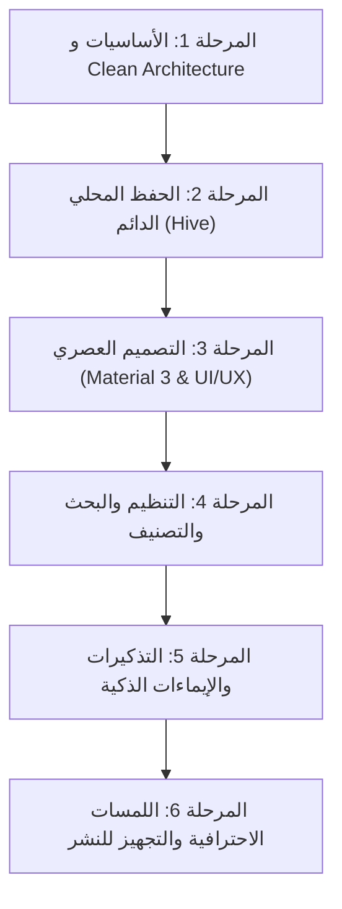

# 📋 وثيقة مراحل وتفاصيل بناء تطبيق المهام (To-Do App)

> **الهدف الأساسي:** الفهم العميق وتثبيت المفاهيم الهندسية في Flutter، وليس مجرد إنجاز تطبيق تقليدي.

---

## 🛠️ القرارات التقنية الثابتة (Architectural Decisions)

| المجال | التقنية المختارة | التفاصيل والتبرير |
| :--- | :--- | :--- |
| **المعمارية (Architecture)** | **Clean Architecture** (Feature-First) | تقسيم المشروع لـ 3 طبقات: (Domain, Data, Presentation) لفصل منطق الأعمال عن الواجهات وقواعد البيانات. |
| **إدارة الحالة (State Management)** | **Cubit** (`flutter_bloc`) | مباشر، خفيف، ومثالي لفهم دورة حياة الحالة دون تعقيد الـ Events. |
| **التخزين المحلي (Local Storage)** | **Hive** (`hive_ce`) | تخزين المهام كـ `Map<String, dynamic>` بدون Code Generation أو `build_runner`. |
| **إدارة النسخ (Git)** | **Conventional Commits & Git Flow** | فروع منظمة (`main`, `develop`, `feature/`) والتزامات ذرية (Atomic Commits). |
| **نظام التصميم (Design System)** | **Material 3** | أحدث معايير التصميم مع `ColorScheme` متناسق ودعم الوضع الليلي. |
| **اللغة والاتجاه** | **العربية أولاً (RTL)** | تجربة عربية كاملة أولاً، مع تهيئة البنية لدعم الإنجليزية لاحقاً. |

---

## 🌿 بروتوكول العمل وإدارة Git

### 1. الفروع (Branches):
* **`main`**: يحتوي فقط على الكود المكتمل والمختبر بعد نهاية كل مرحلة.
* **`develop`**: الفرع التراكمي للتطوير اليومي.
* **`feature/phase-x-...`**: فرع خاص لكل مرحلة مستقلة.

### 2. معايير رسائل الـ Commit (Conventional Commits):
* `feat:` لإضافة ميزة أو ملف جديد (مثل: `feat(domain): add task entity and repository interface`).
* `fix:` لإصلاح مشكلة أو تعديل غير مقصود (مثل: `fix(cubit): fix task deletion undo state`).
* `refactor:` لإعادة ترتيب أو تحسين كود دون تغيير وظيفته.
* `chore:` للمهام التقنية وتعديل الـ dependencies أو تهيئة المجلدات.
* `docs:` لتعديل التوثيق والخطط.

---

## 🗺️ المراحل التفصيلية وخطوات التنفيذ

---

### 🟢 المرحلة 1: الأساسيات و Clean Architecture (In-Memory Core)
> **الهدف التعليمي:** فهم تقسيم Clean Architecture، بناء Cubit، والتعامل مع حالات التطبيق والبيانات في الذاكرة.

* **الخطوة 1.1:** تهيئة هيكل مجلدات Clean Architecture في `lib/` وإضافة الحزم الأساسية (`flutter_bloc`, `equatable`, `uuid`).
* **الخطوة 1.2 (Domain Layer):** 
  * كتابة الكيان `TaskEntity` (Pure Dart - كود مستقل تماماً عن أي إطار عمل).
  * كتابة عقد المستودع `TaskRepository` كـ Abstract Class.
* **الخطوة 1.3 (Data Layer):** 
  * كتابة النموذج `TaskModel`.
  * تطبيق مستودع الذاكرة المؤقتة `InMemoryTaskRepositoryImpl` لتجربة العمليات بدون قاعدة بيانات أولاً.
* **الخطوة 1.4 (Presentation Layer - Cubit):**
  * تصميم حالات `TaskState` (Initial, Loading, Loaded, Error).
  * بناء `TaskCubit` للتحكم في العمليات (إضافة، تعديل، حذف، تغيير حالة الإنجاز).
* **الخطوة 1.5 (Presentation Layer - UI):**
  * بناء شاشة قائمة المهام `TasksPage`.
  * حوار الإضافة والتعديل.
  * حذف المهمة مع إشعار `SnackBar` وزر التراجع (`Undo`).
* **الخطوة 1.6 (Git):** مراجعة الكود، عمل Commits ذرية، ودمج فرع المرحلة الأولى في `develop`.

🏁 **تنتهي المرحلة عندما:** تستطيع فتح التطبيق، وإضافة مهام، وتعديلها، وحذفها مع التراجع، وتغيير حالتها في الذاكرة بنجاح تام.

---

### 🟢 المرحلة 2: الحفظ المحلي الدائم (Hive Persistence)
> **الهدف التعليمي:** تعلم نمط المستودع (Repository Pattern) في استبدال مصدر البيانات دون المساس بالواجهة أو الـ Domain، وتخزين البيانات كـ Map.

* **الخطوة 2.1:** إضافة مكتبة `hive_ce` وتهيئتها في `main.dart` وفتح الـ Box.
* **الخطوة 2.2:** إنشاء مصدر البيانات المحلي `TaskLocalDataSource` للتعامل مع الـ Box مباشرة.
* **الخطوة 2.3:** بناء دوال التحويل اليدوية في `TaskModel`:
  * `toMap()` لتحويل الكائن إلى Map لتخزينه في Hive.
  * `fromMap()` لقراءة البيانات من Hive وتحويلها إلى كائن Dart.
* **الخطوة 2.4:** تطبيق `TaskRepositoryImpl` وربطه مع `TaskLocalDataSource`.
* **الخطوة 2.5:** تعديل `TaskCubit` لتحميل المهام المحفوظة تلقائياً عند فتح التطبيق.

🏁 **تنتهي المرحلة عندما:** تغلق التطبيق تماماً (Kill App) وتعيد فتحه فتجد كل المهام محفوظة كما تركتها.

---

### 🟢 المرحلة 3: التصميم العصري وتجربة الاستخدام (Material 3 & UI/UX)
> **الهدف التعليمي:** إتقان الـ Theming في Flutter، التعامل مع الوضع الليلي، وبناء Reusable Widgets جميلة.

* **الخطوة 3.1:** إعداد لوحة الألوان والخط العربي المناسب في `core/theme/`.
* **الخطوة 3.2:** دعم التبديل بين الوضعين الفاتح والداكن (Light & Dark Theme).
* **الخطوة 3.3:** تصميم بطاقة المهمة (`TaskCard`) بشكل عصري مع تأثيرات بصرية لحالة الإنجاز.
* **الخطوة 3.4:** استبدال حوار الإضافة العادي بـ `ModalBottomSheet` أنيق وسلس.
* **الخطوة 3.5:** تصميم حالة القائمة الفارغة (`Empty State`) مع رسم توضيحي ورسالة مشجعة.

🏁 **تنتهي المرحلة عندما:** يكون مظهر التطبيق جذاباً وعصرياً ومريحاً للعين في كلا الوضعين الليلي والنهاري.

---

### 🟢 المرحلة 4: التنظيم والبحث والتصنيف (Organization & Filtering)
> **الهدف التعليمي:** التعامل مع التواريخ، فلترة القوائم داخل الـ Cubit، وإدارة البحث الفوري.

* **الخطوة 4.1:** توسيع الكيان `TaskEntity` ليشمل:
  * تاريخ ووقت الاستحقاق (`dueDate`).
  * مستوى الأولوية (`Priority`: منخفضة، متوسطة، مرتفعة).
  * تصنيف المهمة (`Category`: عمل، دراسة، شخصي...).
* **الخطوة 4.2:** إضافة شريط البحث المباشر وتحديث القائمة في الـ State دون فقدان القائمة الأصلية.
* **الخطوة 4.3:** أزرار الفلترة السريعة (الكل، النشطة، المكتملة، حسب الأولوية).
* **الخطوة 4.4:** تبويب أو شاشة خاصة لمهام "اليوم" (Today's Tasks).

🏁 **تنتهي المرحلة عندما:** تتمكن من فرز مهامك حسب التاريخ والأولوية والتصنيف والبحث عنها بسرعة.

---

### 🟢 المرحلة 5: التذكيرات والإيماءات الذكية (Reminders & Gestures)
> **الهدف التعليمي:** التعامل مع إشعارات النظام، وإيماءات السحب والإفلات المتقدمة.

* **الخطوة 5.1:** إعداد مكتبة الإشعارات المحلية وجدولة تذكير قبل موعد المهمة.
* **الخطوة 5.2:** إضافة المهام الفرعية (Checklist / Subtasks) داخل المهمة الواحدة.
* **الخطوة 5.3:** إيماءة السحب السريع (`Dismissible`):
  * سحب لليمين: تم الإنجاز.
  * سحب لليسار: حذف.
* **الخطوة 5.4:** إعادة ترتيب المهام بالسحب والإفلات (`ReorderableListView`).

🏁 **تنتهي المرحلة عندما:** يرسل التطبيق إشعاراً في الموعد، وتتحكم في القائمة عبر السحب التفاعلي.

---

### 🟢 المرحلة 6: اللمسات الاحترافية والتجهيز للنشر (Production Polish)
> **الهدف التعليمي:** تجهيز التطبيق ليصبح مشروع سيرة ذاتية (Portfolio) أو جاهزاً للمتجر.

* **الخطوة 6.1:** شاشة إحصائيات بصرية (نسبة الإنجاز الأسبوعية واليومية).
* **الخطوة 6.2:** دعم تعدد اللغات (العربية مع RTL / الإنجليزية مع LTR).
* **الخطوة 6.3:** ميزة النسخ الاحتياطي واستعادة البيانات (تصدير واستيراد ملف JSON).
* **الخطوة 6.4:** شاشة البداية (Splash Screen)، أيقونة التطبيق المخصصة، وصفحات الترحيب للمستخدم الجديد (Onboarding).

🏁 **تنتهي المرحلة عندما:** يكون التطبيق متكاملاً هندسياً وبصرياً وخالياً من أي أخطاء وجاهزاً للنشر أو العرض في معرض أعمالك.
